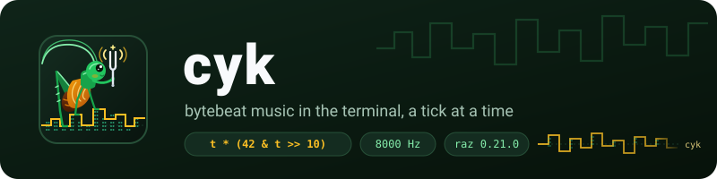
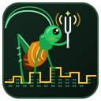
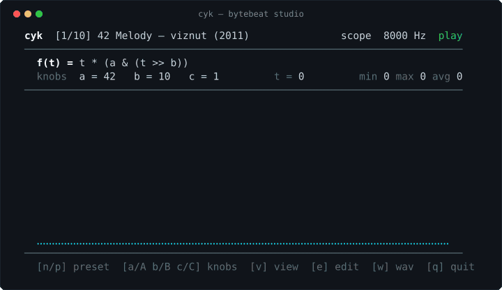

<p align="center">
  
</p>

`cyk` is a bytebeat synthesizer and oscilloscope for the terminal,
written in [raz](https://raz.lucelad.workers.dev) with no C library and
no outside dependencies. A single integer expression over an
incrementing clock `t`, evaluated 8,000 times a second, turns bitwise
arithmetic into chiptune basslines, arpeggios and drums—drawn live in
Unicode braille as it plays.

*Cyk* is Polish for a tick, as of a clock or metronome (`t = 0, 1, 2,
...`), and the chirp of Cyk the cricket, who rubs a square wave out of
nothing but a counter.

<p align="center"></p>

## See it

<p align="center">
  
</p>

Above, `cyk` plays viznut's *42 Melody*, flips from the braille
oscilloscope to the 8-bit waterfall (`v`), steps to *Crowd* (`n`),
nudges the knobs (`a`, `b`), and edits the formula live (`e`). The same
recording is in [`doc/demo.cast`](doc/demo.cast):

    asciinema play doc/demo.cast

It is made by `robbie cast`, not filmed by hand, so it never goes out of
date. Without colour, the oscilloscope and the bit-plane waterfall look
like this:

```
cyk  [1/10] 42 Melody — viznut (2011)               scope  8000 Hz  play
────────────────────────────────────────────────────────────────────────
  f(t) = t * (a & (t >> b))
  knobs  a = 42   b = 10   c = 1     t = 2048      min 0 max 254 avg 127
────────────────────────────────────────────────────────────────────────
  ⠀⠀⠀⠀⠀⠀⠀⠀⠀⠀⠀⠀⠀⠀⠀⠀⠀⠀⠀⠀⠀⠀⠀⠀⠀⠀⠀⠀⠀⠀⢀⣠⠴⠋⡇⠀⠀⠀⠀⠀⠀⠀⠀⠀⠀⠀⠀⠀⠀⠀⠀⠀⠀⠀⠀⠀⠀⠀⠀⠀⠀⠀⠀⠀⢀⣠⠴⠋
  ⠀⠀⠀⠀⠀⠀⠀⠀⠀⠀⠀⠀⠀⠀⠀⠀⠀⠀⠀⠀⠀⠀⠀⠀⠀⠀⢀⣠⠴⠚⠉⠀⠀⠀⡇⠀⠀⠀⠀⠀⠀⠀⠀⠀⠀⠀⠀⠀⠀⠀⠀⠀⠀⠀⠀⠀⠀⠀⠀⠀⢀⣠⠴⠚⠉⠀⠀⠀
  ⠀⠀⠀⠀⠀⠀⠀⠀⠀⠀⠀⠀⠀⠀⠀⠀⠀⠀⠀⠀⠀⠀⢀⣠⠴⠚⠉⠀⠀⠀⠀⠀⠀⠀⡇⠀⠀⠀⠀⠀⠀⠀⠀⠀⠀⠀⠀⠀⠀⠀⠀⠀⠀⠀⠀⠀⢀⣠⠴⠚⠉⠀⠀⠀⠀⠀⠀⠀
  ⠀⠀⠀⠀⠀⠀⠀⠀⠀⠀⠀⠀⠀⠀⠀⠀⠀⠀⠀⣠⠴⠒⠋⠀⠀⠀⠀⠀⠀⠀⠀⠀⠀⠀⡇⠀⠀⠀⠀⠀⠀⠀⠀⠀⠀⠀⠀⠀⠀⠀⠀⠀⠀⣠⠴⠒⠋⠀⠀⠀⠀⠀⠀⠀⠀⠀⠀⠀
  ⠀⠀⠀⠀⠀⠀⠀⠀⠀⠀⠀⠀⠀⠀⠀⣀⡴⠒⠋⠁⠀⠀⠀⠀⠀⠀⠀⠀⠀⠀⠀⠀⠀⠀⡇⠀⠀⠀⠀⠀⠀⠀⠀⠀⠀⠀⠀⠀⠀⣀⡴⠒⠋⠁⠀⠀⠀⠀⠀⠀⠀⠀⠀⠀⠀⠀⠀⠀
  ⠀⠀⠀⠀⠀⠀⠀⠀⠀⠀⠀⣀⡤⠖⠋⠁⠀⠀⠀⠀⠀⠀⠀⠀⠀⠀⠀⠀⠀⠀⠀⠀⠀⠀⡇⠀⠀⠀⠀⠀⠀⠀⠀⠀⠀⣀⡤⠖⠋⠁⠀⠀⠀⠀⠀⠀⠀⠀⠀⠀⠀⠀⠀⠀⠀⠀⠀⠀
  ⠀⠀⠀⠀⠀⠀⠀⣀⡤⠖⠋⠁⠀⠀⠀⠀⠀⠀⠀⠀⠀⠀⠀⠀⠀⠀⠀⠀⠀⠀⠀⠀⠀⠀⡇⠀⠀⠀⠀⠀⠀⣀⡤⠖⠋⠁⠀⠀⠀⠀⠀⠀⠀⠀⠀⠀⠀⠀⠀⠀⠀⠀⠀⠀⠀⠀⠀⠀
  ⠀⠀⠀⣀⡤⠴⠋⠁⠀⠀⠀⠀⠀⠀⠀⠀⠀⠀⠀⠀⠀⠀⠀⠀⠀⠀⠀⠀⠀⠀⠀⠀⠀⠀⡇⠀⠀⣀⡤⠴⠋⠁⠀⠀⠀⠀⠀⠀⠀⠀⠀⠀⠀⠀⠀⠀⠀⠀⠀⠀⠀⠀⠀⠀⠀⠀⠀⠀
  ⣠⠴⠚⠁⠀⠀⠀⠀⠀⠀⠀⠀⠀⠀⠀⠀⠀⠀⠀⠀⠀⠀⠀⠀⠀⠀⠀⠀⠀⠀⠀⠀⠀⠀⣧⠴⠚⠁⠀⠀⠀⠀⠀⠀⠀⠀⠀⠀⠀⠀⠀⠀⠀⠀⠀⠀⠀⠀⠀⠀⠀⠀⠀⠀⠀⠀⠀⠀
────────────────────────────────────────────────────────────────────────
  [n/p] preset  [a/A b/B c/C] knobs  [v] view  [e] edit  [w] wav  [q] quit
```

While you edit a formula (`e`), `cyk` compiles after every keystroke. If
the expression is half-written, the old one keeps playing without a
hiccup while the caret shows where the new one stopped making sense:

```
  f(t) = t * (a & (t >> b))+
                            ^
  knobs  a = 42   b = 10   c = 1     t = 2048      min 0 max 254 avg 127
```

## Get it

`cyk` is built with [robbie](../robbie), tested with
[concha](../concha), and tracked with [sauce](../sauce):

    robbie              # list tasks, files and variables
    robbie build/cyk    # compile build/cyk
    robbie check        # Beat's and Wave's tests, test/cases, and man page
    robbie install      # cyk and man cyk into ~/.local

Or compile it directly with `raz` alone:

    raz -Werror -I src -o build/cyk src/Cyk.raz

## Learn it

    cyk                                 # start at preset 1, 42 Melody
    cyk -p 2                            # start at preset 2, Crowd
    cyk 't * (t >> 8 | t >> 9)'         # play your own formula
    cyk -w tune.wav -d 10 -p 3          # write 10 seconds to a RIFF .wav file
    cyk -l                              # list the 10 built-in tunes

`man ./doc/cyk.1` has every option and operator. The keys are few:

| Key | What it does |
|---|---|
| `n` `p`, or `Right` `Left` | the next or previous tune in the deck |
| `1`..`9`, `0` | Tunes 1 to 10 directly |
| `a` `A`, `b` `B`, `c` `C` | raise or lower knob `a`, `b` or `c` by 1 |
| `+` `-` | raise or lower the sample rate by 1,000 Hz |
| `v` | switch between the oscilloscope (`scope`) and the 8-bit waterfall (`bits`) |
| `e` or `/` | edit the formula live (`Enter` or `Esc` finishes, `C-u` clears) |
| `Space`, `.`, `r` | pause or resume; step 256 samples; reset `t` and the tune |
| `w` | write 5 seconds of the current formula to `cyk.wav` |
| `q` or `Esc` | quit |

## How it works

Three ideas, a module each.

**1. A tiny stack machine** ([`src/Beat.raz`](src/Beat.raz)). A formula
is parsed once by precedence climbing into a flat array of `variant`
instructions (`[128]Op`). For `t * (42 & (t >> 10))`:

```
ops:   pushT  pushK(42)  pushT  pushK(10)  shrOp  bitAnd  mul
```

Evaluating 256 samples for a frame is a plain loop over `ops` with a
64-word stack and no heap allocation. Bytebeat formulas divide by
expressions that often reach zero; `Beat.eval` guards `/` and `%`
against zero and `MIN(I64) / -1` so no formula can fault the program.

**2. Two ways to see a byte** ([`src/Wave.raz`](src/Wave.raz)). Each
terminal cell holds a 2×4 grid of Unicode braille dots (`U+2800` to
`U+28FF`):

```
col 0   col 1
(01H)   (08H)   row 0
(02H)   (10H)   row 1
(04H)   (20H)   row 2
(40H)   (80H)   row 3
```

In `scope` view, `Wave.scopeRow` plots sample amplitude from 0 at the
bottom to 255 at the top, joining adjacent columns vertically so steep
square waves draw unbroken edges. In `bits` view, `Wave.bitsRow` plots
the eight bits of each sample from bit 7 at the top to bit 0 at the
bottom, exposing the binary counters and Sierpiński triangles that make
the rhythm. `Wave.writeWav` writes the same bytes out behind a 44-byte
RIFF `WAVE` header.

**3. Live editing that never drops the beat**
([`src/Cyk.raz`](src/Cyk.raz)). Keystrokes in edit mode compile into a
candidate `Beat.Prog`. Only when `Beat.compile` returns `nil` does the
candidate replace the running program; otherwise the active program
carries on while the screen marks `errPos` with `^`. When `aplay` or
`pw-play` is on the system (and `-n` is not given), `Cyk` pipes the
sample stream to it. Either way `t` follows the clock, not the frame
rate: each frame plays the samples the clock has moved on since the
last, and the player is kept 80 ms ahead so it never runs dry.

## Reading the code

Read [`src/Beat.raz`](src/Beat.raz) first (the compiler, stack machine,
deck of ten tunes, and its self-test), then
[`src/Wave.raz`](src/Wave.raz) (braille rendering and `.wav` output,
with its test), and finally [`src/Cyk.raz`](src/Cyk.raz) from top to
bottom.

## Correctness and tests

- Every division, modulo and shift in a user formula is total: `/ 0` and
  `% 0` give `0`, `MIN(I64) / -1` gives `0`, and shift counts are masked
  to `0..63`.
- Nothing from the command line or keyboard is passed to a shell; the
  optional audio helper is started by `Sys.spawn` with an explicit path
  and argument array.
- `robbie check` runs `Beat`'s and `Wave`'s unit tests, six headless
  screen cases in `test/cases/` via `test/check.cn`, `.wav` file
  verification, and `groff -mandoc -Tutf8 -ww -z` on `doc/cyk.1`.

## Size

`robbie loc` counts the lines of code, leaving out comments and blank
lines:

| Module | Lines of code |
|---|---:|
| [`src/Beat.raz`](src/Beat.raz) | 625, its test and 10 presets included |
| [`src/Wave.raz`](src/Wave.raz) | 284, its test included |
| [`src/Cyk.raz`](src/Cyk.raz) | 742 |

## Left out

On purpose, to stay small: floating-point (`floatbeat`) formulas, stereo
channels, MIDI input, and multi-line programs.

## Licence

ISC; see [LICENSE](LICENSE).
